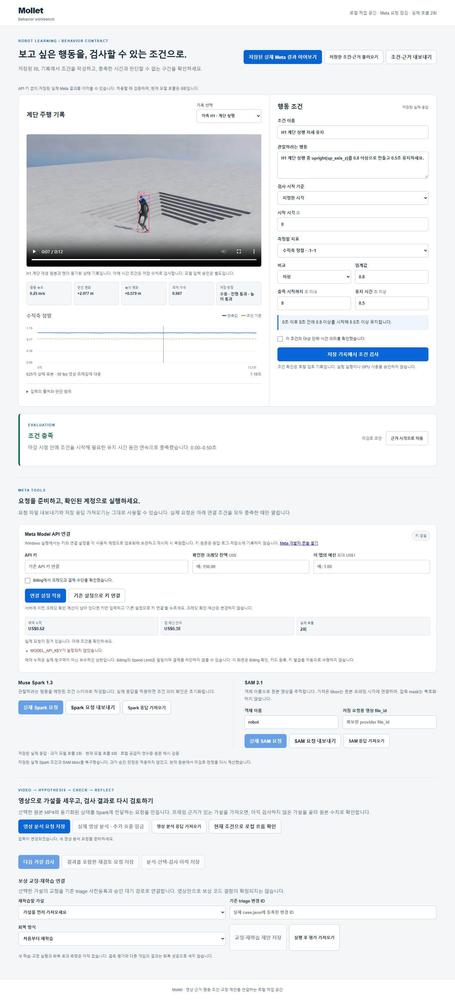

# Mollet

Mollet is a behavior-condition workbench for recorded robot runs. It turns a plain-language intent into a reviewable condition, joins that condition with state traces and video observations, and preserves the evidence used for the verdict.

This repository contains the Meta AI Developer Hackathon application built on the existing [RL Triage Agent](README-RL-TRIAGE.md). The hackathon work adds the browser workbench, Meta model adapters, saved-response replay, condition evaluation and export, and the three-minute demonstration. It does not claim that a new policy was trained or that recovery performance improved.

[Watch the 180-second demo with English captions](submission/meta-recovery-demo-20261105-v2/mollet-meta-recovery-demo-180s-en-captioned.mp4) · [한국어 영상](submission/meta-recovery-demo-20261105-v2/mollet-meta-recovery-demo-180s-ko.mp4) · [Evidence manifest](submission/meta-recovery-demo-20261105-v2/manifest.json) · [Apache-2.0 license](LICENSE)



## What the demo proves

The recorded H1 stairs example restores one completed Muse Spark 1.3 response and one completed SAM 3.1 response. The restored provider condition checks vertical-axis alignment `>= 0.8`, with an 8-second deadline and a 0.5-second hold. It returns PASS over `0.0–0.5 s`.

The reviewer then changes the hold to 8 seconds. The local evaluator checks all 625 state samples and returns PASS over `0.0–8.0 s`. A recorded Go2 downhill trace is checked over its full 12.48-second window and returns FAIL because the robot overturns near the end.

SAM returned object locations for 624 of 625 video frames. That figure is response coverage, not tracking accuracy: no labeled ground truth was used to measure accuracy.

| Evidence | Recorded result | Scope |
| --- | --- | --- |
| Muse Spark 1.3 | 1 completed HTTPS response | Generated the saved H1 behavior contract |
| SAM 3.1 | 1 completed HTTPS response | Returned frame-indexed robot bounding boxes |
| Saved H1 condition | PASS, `0.0–0.5 s` | Threshold `0.8`, deadline `8 s`, hold `0.5 s` |
| Reviewer-edited H1 condition | PASS, `0.0–8.0 s` | Local evaluation over 625 state samples |
| Recorded Go2 condition | FAIL | Manual state-trace check over 12.48 seconds |
| SAM response coverage | 624 bounding-box locations / 625 frames | Coverage only; accuracy was not measured |

The receipts, hashes, browser checks and exported contracts are preserved in [the browser verification record](evals/results/meta_recovery_browser_20261105_v5/verification.json) and [the provider verification record](evals/results/meta_live_provider_20261104_v1/verification.json).

## How it works

1. Select one of six recorded stair clips: H1 up/down or Go2 up/down at two command speeds.
2. Restore a saved Meta result or author a bounded time condition in the browser.
3. Review the metric, threshold, deadline and required hold time.
4. Join the condition with the source-bound state trace and SAM bounding-box observations.
5. Evaluate the full observation window as PASS, FAIL or UNKNOWN.
6. Export the condition, verdict and provenance as JSON, then reopen it for a round-trip check.

The evaluator preserves uncertainty. Missing samples, a broken tracking interval, an incomplete observation window or unavailable raw state data return UNKNOWN instead of guessing.

## Run locally

Python 3.11–3.13 is supported. The saved-result path needs no API key and installs no new package.

```powershell
cd "$HOME/mollet-meta"
$env:PYTHONPATH = "$PWD/src"
python -m rl_triage.behavior_authoring serve --port 8784
```

Open <http://127.0.0.1:8784> and choose **저장된 실제 Meta 결과 이어보기** at the top of the page. The workbench restores the original condition and SAM boxes without an API key or another provider request.

The public clone does not include the private raw provider files kept outside the repository. In that case, the workbench reports `repository_evidence_verified`, a lower evidence level than verifying those local raw receipts. It is not new provider authentication.

File import is a second path. Choose **저장한 조건·근거 불러오기** and select:

```text
evals/results/meta_live_provider_20261104_v1/mollet-behavior-contract.json
```

The import verifies source hashes, restores the saved condition and SAM boxes, drops the old approval state, and recalculates an unreviewed verdict. No new provider request is made.

For a CLI-only sample:

```powershell
$env:PYTHONPATH = "$PWD/src"
python -m rl_triage.behavior_authoring demo --out "$HOME/meta-behavior-demo"
```

Existing output paths are not overwritten.

## Evidence boundaries

The three-minute video replays saved historical Meta responses in the current browser. Capture and rendering made zero new model calls, zero new video-inference calls, zero reflection calls, zero training jobs and zero GPU jobs.

The repository contains interfaces for frame-grounded hypotheses, condition checks, reflection requests, registered correction proposals and fixed recovery comparison. New video inference, reflection-driven iteration, policy correction, retraining and recovery-improvement measurement were not run for this submission. The Go2 verdict is a manual check of a recorded state trace, not a new model diagnosis.

Live requests are optional and locked behind a local API key, confirmed credit, a request budget and per-video authorization. Credentials and runtime authentication profiles are not stored in this repository.

## What is new and what is reused

### New hackathon contribution

- Browser workbench for selecting six biped and quadruped stair recordings
- Restricted behavior-condition schema and PASS/FAIL/UNKNOWN time-window evaluator
- Muse Spark 1.3 contract generation and SAM 3.1 video-observation adapters
- Source-hash verification, saved-response replay, review reset and JSON round trip
- Frame-grounded hypothesis, reflection-request and registered-correction bridge interfaces
- Reproducible browser evidence and Korean/English 180-second demo assets

### Reused foundation

- Recorded Isaac Lab H1 and Go2 videos and state traces
- RL Triage Agent telemetry, registered correction and fixed evaluation components
- Earlier policy training, recovery experiments and their evidence history

The reused foundation remains documented in [README-RL-TRIAGE.md](README-RL-TRIAGE.md). The complete repository is released under [Apache License 2.0](LICENSE).

## Verify

Run the Meta-focused test set:

```powershell
cd "$HOME/mollet-meta"
$env:PYTHONPATH = "$PWD/src"
$tests = @(Get-ChildItem tests -Filter 'test_behavior_authoring_*.py' | ForEach-Object FullName)
$tests += (Resolve-Path 'tests/test_behavior_improvement.py').Path
$tests += @(Get-ChildItem tests -Filter 'test_meta_*.py' | ForEach-Object FullName)
python -m pytest -q @($tests | Sort-Object -Unique)
```

The checked-in evidence also records the browser replay, source hashes, media hashes, provider receipts and the fully decoded demo outputs:

- [Browser verification](evals/results/meta_recovery_browser_20261105_v5/verification.json)
- [Live-provider verification](evals/results/meta_live_provider_20261104_v1/verification.json)
- [Demo manifest](submission/meta-recovery-demo-20261105-v2/manifest.json)
- [Behavior authoring details](docs/META-BEHAVIOR-AUTHORING.md)

## 한국어 요약

Mollet은 로봇 영상과 상태 기록에서 행동 조건을 작성하고, 조건이 유지된 구간과 판정 근거를 함께 내보내는 작업 공간입니다. 이번 제출에는 저장된 실제 Spark·SAM 응답을 검증해 복원하는 흐름, H1 8초 자세 조건 재검사, Go2 12.48초 전 구간 실패 판정, JSON 내보내기와 재불러오기가 들어 있습니다.

영상 추론과 reflection 반복, 정책 수정, 재학습, 회복 성능 향상 측정은 이번 제출에서 실행하지 않았습니다. 624/625 bbox는 SAM 응답이 제공된 프레임 수이며 정확도 수치가 아닙니다. 기존 RL 기반과 새 Meta 해커톤 기능의 범위는 위 항목에서 나눠 적었습니다.
